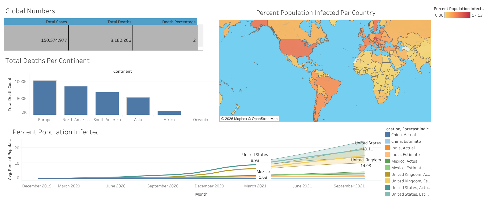

# COVID-19 Data Exploration & Visualization

## Project Overview
Analyzed global COVID-19 data using SQL Server and Tableau to explore reported cases, deaths, infection rates, and vaccination trends across countries and continents.

## Tools & Technologies
- SQL Server (SSMS)
- Tableau
- Microsoft Excel

## Key Analysis
- Calculated infection and death percentages.
- Identified countries with the highest reported infection rates.
- Compared death counts across countries and continents.
- Analyzed global COVID-19 statistics.
- Calculated rolling vaccination totals.

## SQL Skills Demonstrated
- Joins and Aggregate Functions
- CTEs and Temporary Tables
- Window Functions
- Views
- Data Type Conversion

## Tableau Dashboard
Created an interactive dashboard to visualize global COVID-19 statistics, geographical infection patterns, and country-level trends.
[View Interactive Tableau Dashboard](https://public.tableau.com/app/profile/ramandeep.kaur3820/viz/COVID-19GlobalOverview_17916190887920/Dashboard1)

## Project Files
- [SQL Queries](COVID%20Portfolio%20Project.sql)

## Dataset & Credits
- [Our World in Data](https://ourworldindata.org/coronavirus)
- [Alex The Analyst - Portfolio Projects](https://github.com/AlexTheAnalyst/PortfolioProjects)

### Dashboard Preview

